<!-- Generat amb scripts/guia_desde_gdoc.py a partir del Google Doc. No l'editis a mà: els canvis es fan al document. -->

# Guia per als participants { #guia-per-als-participants }

*Repair Cafè Vincle Digital · 18 de novembre*

Aquesta guia explica com recondicionarem els mòbils donats perquè algú altre pugui tornar-los a fer servir, a través del Parc Sanitari Sant Joan de Déu (PSSJD).

Cada mòbil ha de quedar registrat a DeviceHub, l’inventari d’AUCOOP basat en la iniciativa [eReuse.org](http://eReuse.org) de la que AUCOOP n’és part. En aquest inventari també ha de quedar anotada cada decisió que es prengui sobre cada mòbil concret, ja sigui com a canvi d’estat o com a nota.

En aquest taller farem la primera part del procés: registre, inspecció i test. Abans del lliurament final, els voluntaris d’AUCOOP completaran el procés al PSSJD: prova d’estrès de la bateria, prova de la SIM i, si cal, un reset de fàbrica.

## Com treballarem { #com-treballarem }

- Treballem en grups de 2.
- Necessitareu el mòbil o el portàtil d’un de vosaltres per fer el registre del telèfon que recondicionareu (li direm **DRA** al **D**ispositiu a **R**econdicion**A**r).
- Si necessiteu connectar-vos a Internet podeu fer servir la WiFi:

Nom del SSID:  Vincle\_Digital\_Telecos

Contrasenya d'accés:  V1ncleD1g1tal!

- Material i eines (demana’ls als voluntaris, i torna-lis quan acabis de fer-los servir):
    - [ ] Pinxo per obrir la safata de la targeta SIM del DRA.
    - [ ] Tester de càrrega del DRA (i potser un cable per adaptar diferent tipus de USB).
    - [ ] Gomets per marcar els DRAs
    - [ ] Carregador i cable (USB-C o micro-USB, segons el mòbil). Aquests es quedaran amb el DRA si l’aconseguim recondicionar per donació.

## El principi i el final { #el-principi-i-el-final }

Els DRA són a la caixa d'entrada.

Cada DRA ja porta una etiqueta amb un número que ens permet identificar-lo.

Si has portat DRAs, demana a un voluntari etiquetes amb els números d’identificació per registrar al DeviceHub. I no oblidis que només podem treballar amb DRAs que estiguin desbloquejats i sense dades de l’anterior propietari.

Segueix el procés de recondicionament que t’indiquem en aquesta guia. Quan acabis has de deixar el DRA (apagat!!) en una de les quatre caixes de sortida. L'estat final del DRA que poses a DeviceHub i el color del gomet que li poses al DRA han de coincidir amb la caixa de sortida on el deixes.

Quan acabis el procés amb un DRA i l’hagis depositat en una de les caixes de sortida, pots anar a buscar un de nou a la caixa d’entrada.

### Protocol de tancament (Fes-ho SEMPRE amb cada mòbil) { #protocol-de-tancament-fes-ho-sempre-amb-cada-mobil }

Quan acabis el procés d'un mòbil (tant si és per descartar-lo, perquè està bloquejat o perquè ha passat el test), segueix **SEMPRE aquests 5 passos en aquest ordre**:

1. **DeviceHub:** Canvia l'estat del mòbil segons la caixa on anirà.
1. **Nota:** Afegeix una nota breu explicant el motiu o el resultat del test.
1. **Gomet:** Enganxa al telèfon el gomet del color corresponent a la caixa.
1. **Apaga el telèfon completament**. (Mai no deixis un mòbil encès a la caixa).
1. **Caixa:** Diposita el mòbil a la seva caixa de sortida corresponent.

| **Caixa de sortida/gomet** | **Estat a DeviceHub** | **Quan** |
|---|---|---|
| 🔴 Vermella (gomet vermell) | Per-desmantellar | Té un dany evident (bateria inflada, pantalla trencada, mullat) o és massa antic[^1]. |
| 🟡 Groga (gomet groc) | Per-revisar | No carrega, no s'encén o encara té dades de l'antic proprietari. |
| 🔵 Blava (gomet blau) | Pendent-donant | Demana un PIN o el compte de Google anterior. |
| 🟢 Donació (gomet verd) | Per-donació | Ha passat el test de Workbench Android. |

Així canvia l'estat d'un DRA a DeviceHub:[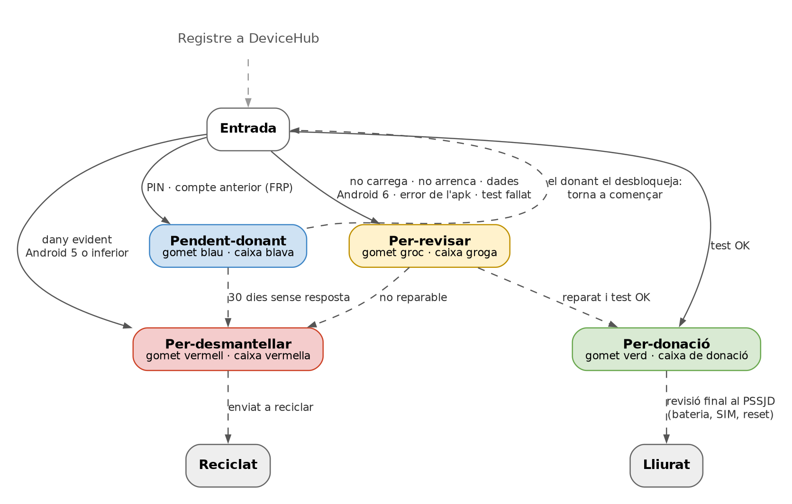{ width="586" loading=lazy }](guia/img/9796c25cd830.png)

## El circuit sencer d'un cop d'ull { #el-circuit-sencer-d-un-cop-d-ull }

És un resum del pas a pas que trobaràs a les següents pàgines. La llegenda funciona així:

- Al requadre de color: el DRA hi va apagat i amb el gomet del mateix color.
- Al requadre discontinu: és un avís i el DRA continua.

    [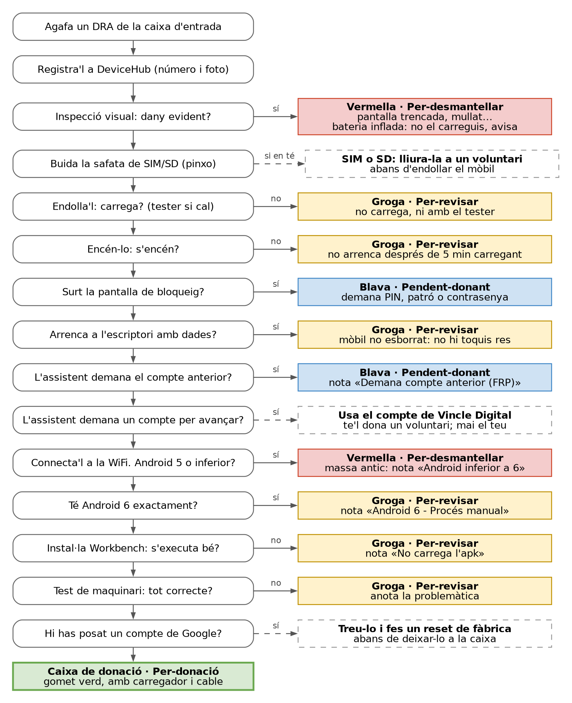{ width="560" loading=lazy }](guia/img/ec64bcd1a4b1.png)

## Registre del DRA a DeviceHub Pas per Pas { #registre-del-dra-a-devicehub-pas-per-pas }

**Salta a un pas:** [1 Entra](#pas-1) · [2 Formulari](#pas-2) · [3 Número](#pas-3) · [4 Foto](#pas-4) · [5 Inspecció](#pas-5) · [6 SIM/SD](#pas-6) · [7 Càrrega](#pas-7) · [8 Encén](#pas-8) · [9 Pantalla](#pas-9) · [10 Workbench](#pas-10) · [11 Configura](#pas-11) · [12 Test](#pas-12) · [13 Envia](#pas-13) · [14 Final](#pas-14)

### 1. Entra a DeviceHub { #pas-1 }

Fes servir el teu mòbil o portàtil per llegir aquest QR cap a [https://lab6.ereuse.org/](https://lab6.ereuse.org/) i així anar al formulari de registre de l’inventari de DRAs que AUCOOP ha creat amb DeviceHub.

[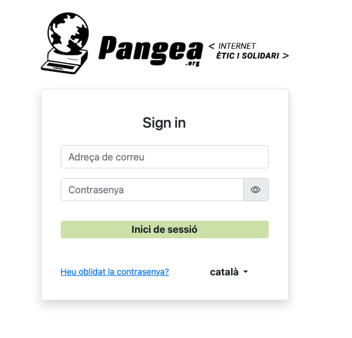{ width="300" loading=lazy }](guia/img/85095645aba8.png)

Fes servir el nom d'usuari i password que et donem amb aquesta guia per entrar al formulari de registre.

### 2. Obre el formulari web { #pas-2 }

Un cop hagis entrat, tria “Evidències” \> “Puja formulari web” i t’hauria de sortir aquesta pantalla:

[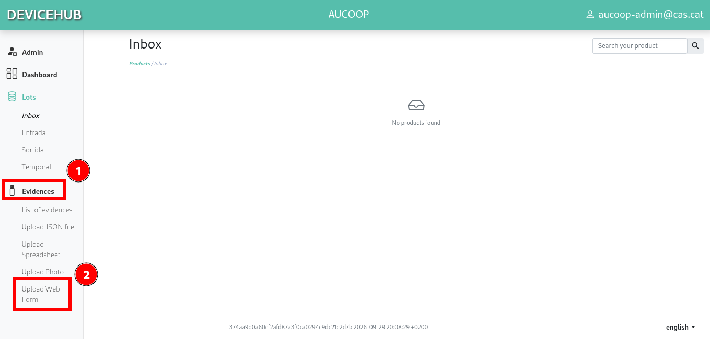{ width="533" loading=lazy }](guia/img/cb201a414178.png)[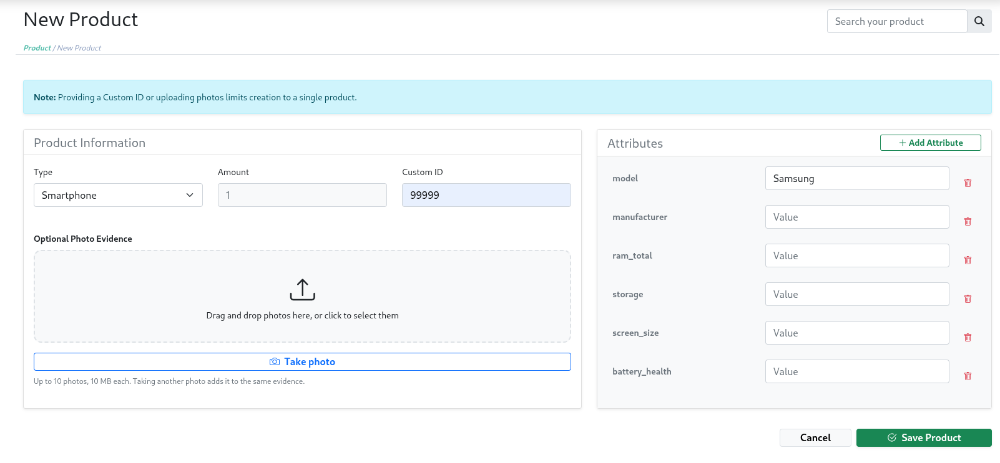{ width="533" loading=lazy }](guia/img/4b1730853d16.png)

### 3. Escriu el número del DRA { #pas-3 }

Introdueix el número del teu DRA a la casella “**Custom ID**”

Per exemple, en aquest DRA, el Custom ID és el 325.

[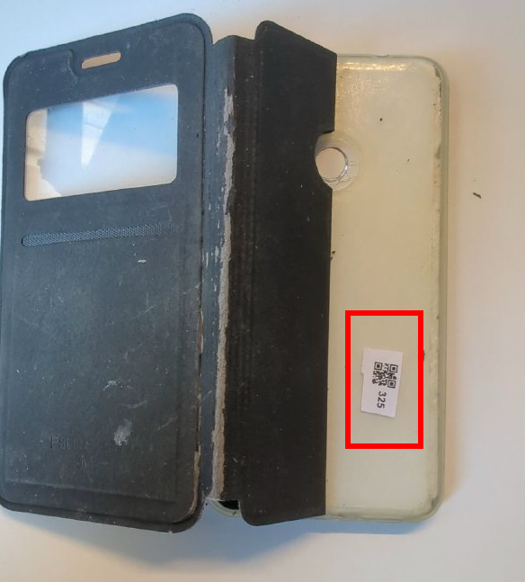{ width="200" loading=lazy }](guia/img/3c0619af6fc4.png)

### 4. Fes-li una foto { #pas-4 }

Fes una foto del DRA i puja-la al DeviceHub.

[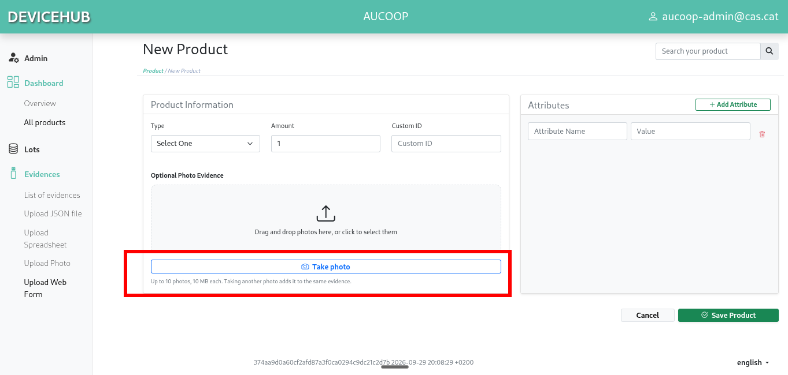{ width="533" loading=lazy }](guia/img/3aa4ef69f8fe.png)

Un cop pujada la foto, si vas a Dashboard -\> All Products hauries de veure el DRA que acabes de registrar amb el formulari

[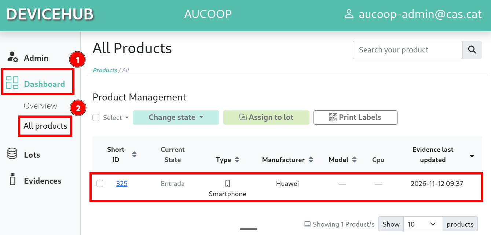{ width="533" loading=lazy }](guia/img/3b1677078c5c.png)

Si fas clic al número, veuràs una pantalla amb detalls sobre el dispositiu.

[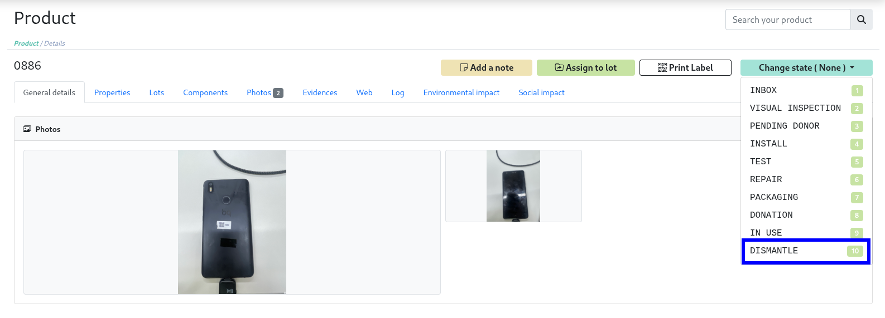{ width="533" loading=lazy }](guia/img/42dfd5a42a92.png)

### 5. Inspecció visual de l’aspecte exterior del DRA { #pas-5 }

1. Si sembla que està bé passa al punt 6.
1. Si veus que no serà útil (bateria inflada, pantalla trencada, etc), marca a DeviceHub l’estat Per-desmantellar i afegeix una nota amb el motiu. [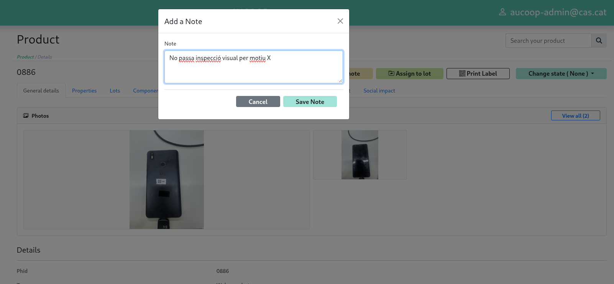{ width="511" loading=lazy }](guia/img/659e7969ff6b.png)
1. 

    !!! danger ""
        **Si està la bateria inflada:** no el carregis ni l’obris! Avisa un voluntari.

    1. Marca el DRA amb el gomet vermell i deixa’l a la caixa de Per-desmantellar. Comprova primer que estigui apagat.
    1. Torna a començar amb un nou DRA.

### 6. Comprovació de SIM / Targeta SD { #pas-6 }

!!! warning ""
    **MOLT IMPORTANT:** Revisa i buida la safata de targetes SIM o SD  **abans d'endollar o intentar encendre el mòbil**. Així s'eviten manipulacions innecessàries amb targetes posades o risc de pèrdua de dades personals del donant.

- Demana l'eina d'extracció ("pinxo") a un voluntari.
- Comprova si el DRA conté una targeta SIM o microSD.
- **Si trobes una SIM o SD:** Treu-la i **lliura-la immediatament a un voluntari d'AUCOOP** (el voluntari la guardarà de forma segura i anotarà les dades del mòbil per si cal contactar amb el donant).
- Torna a inserir la safata buida al mòbil i passa al punt 7.

### 7. Comprova si carrega { #pas-7 }

- Endolla'l al carregador. Surt la icona de càrrega o s'encén el LED?
    - **Sí**: passa a 8.
    - **No**: demana un tester USB a un voluntari i connecta’l al DRA. Consumeix corrent?
        - **Sí**: treu el tester, deixa'l carregant amb el carregador i continua.
        - **No**: Posa a DeviceHub la nota "No carrega", i l’estat Per-revisar. Posa-li un gomet groc al DRA i deixa’l a la caixa groga.

            [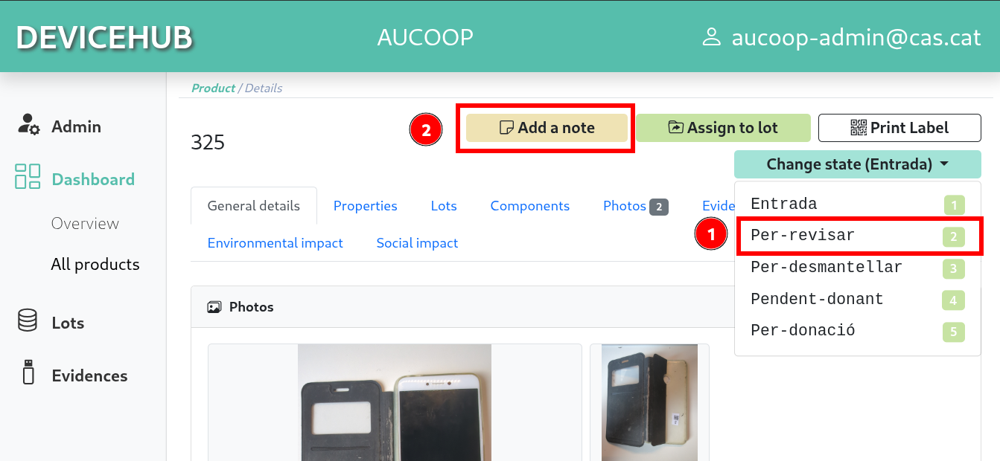{ width="533" loading=lazy }](guia/img/ea49be1708f5.png)

            [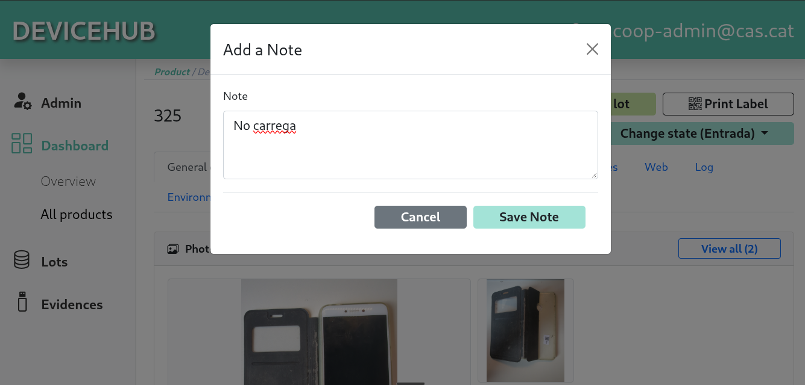{ width="533" loading=lazy }](guia/img/441ee1830ded.png)

        - Torna el tester al voluntari quan acabis de fer-lo servir.
        - Agafa un altre DRA i ves al punt 2 ;-) .

### 8. Encén el DRA { #pas-8 }

- Deixa'l endollat i intenta encendre'l.
    - **S'encén**: passa al punt 9.
    - **No s'encén**: espera 5 minuts i torna-ho a provar.
        - Si encara no s'encén: posa a DeviceHub la nota: "No arrenca després de carregar 5 minuts", i l’estat Per-revisar**.** Posa un gomet groc al DRA i deixa a la caixa groga Per-revisar**.**

            [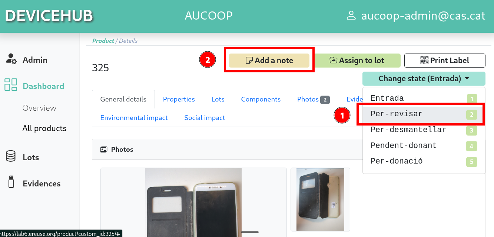{ width="533" loading=lazy }](guia/img/938274874504.png)

            [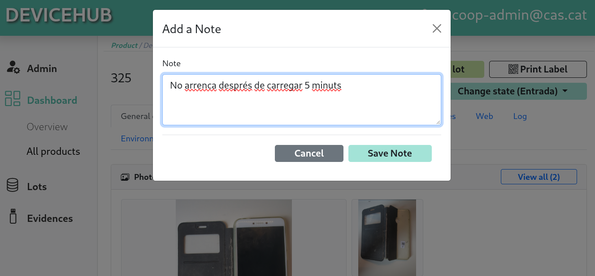{ width="533" loading=lazy }](guia/img/095b0ba5ff65.png)

### 9. Mira què surt a la pantalla { #pas-9 }

- Si surt **Pantalla de bloqueig** (PIN, patró o contrasenya):
    - Posa a DeviceHub una nota que digui "Demana PIN" i marca l’estat Pendent-donant**.**

        [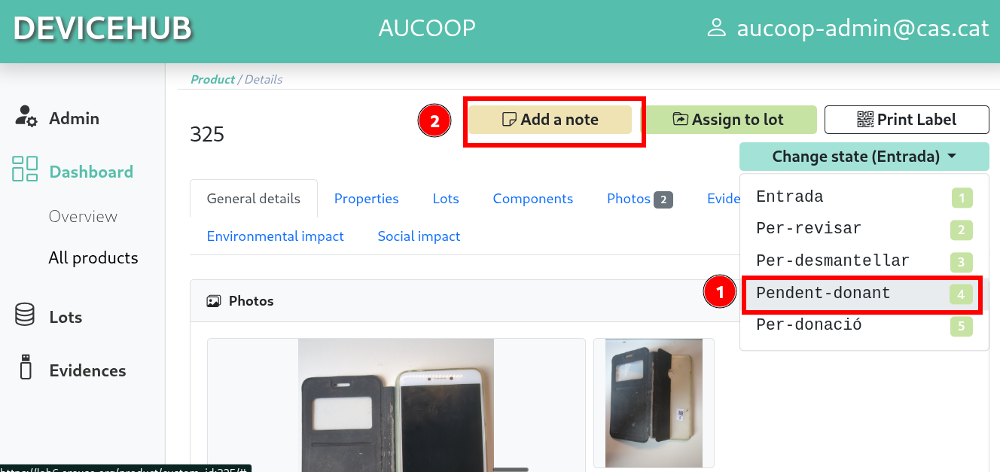{ width="533" loading=lazy }](guia/img/68c825010f70.png)

        [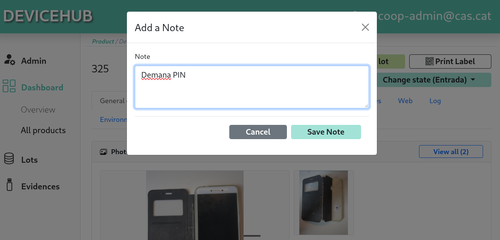{ width="533" loading=lazy }](guia/img/86ed3d89ae22.png)

    - Al DRA posa-li un gomet blau. Apaga'l i deixa'l a la caixa blava Pendent-donant.
    - **No provis PINs a l'atzar!**. Després de diversos intents el mòbil es bloqueja o s'esborra.
- Si surt l’**Escriptori amb les aplicacions i dades de l'antic propietari**: no hi toquis res!
    - Posa a DeviceHub la nota: "Mòbil no esborrat", l’estat Per-revisar i posa-li al DRA el gomet groc.
    - Apaga'l i deixa'l a la caixa groga.
- **Si surt l'Assistent de configuració inicial:** ves seguint les instruccions, ometent tots els passos de configuració que puguis fins a arribar a l'escriptori o pantalla d'inici.
    - Si demana el compte de Google de l'antic propietari (FRP): Posa a DeviceHub la nota *"Demana compte anterior (FRP)"*, marca l'estat Pendent-donant**.** Al DRA posa-li un gomet blau. Apaga'l i deixa'l a la caixa blava Pendent-donant**.**

        [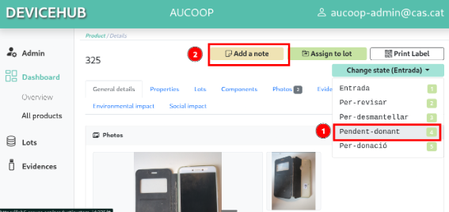{ width="533" loading=lazy }](guia/img/f1674783eb91.png)

        [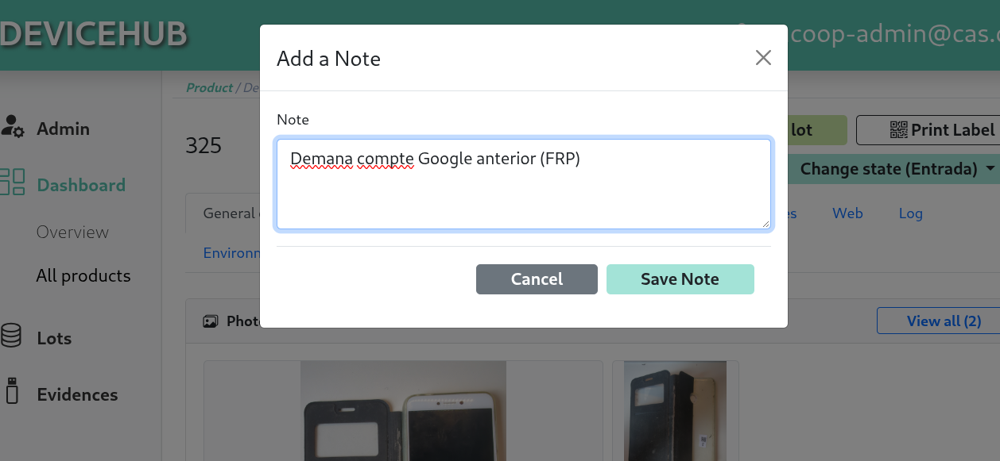{ width="533" loading=lazy }](guia/img/2c250f252f4c.png)

    - Si demana iniciar sessió amb un compte de Google per poder avançar: Demana a un voluntari les dades del compte de **Vincle Digital**.

        !!! danger ""
            **ATENCIÓ SEGURETAT:** **MAI NO** **utilitzis el teu compte personal de Google o iCloud.** Fes servir únicament el compte genèric de Vincle Digital que et facilitarà un voluntari.

- Si has deixat el DRA a una caixa de sortida (assegura’t que l’has deixat apagat), ves a buscar un altre i comença de nou per 2.

### 10. Instal·la Workbench Android { #pas-10 }

- Connecta el DRA a la WiFi: Nom del SSID: Vincle\_Digital\_Telecos , Contrasenya d'accés:  V1ncleD1g1tal!
- Comprova la versió del telèfon a: **Ajustos \> Informació del telèfon (o Sistema) \> Versió d'Android**.
- Actua segons la versió que tingui el mòbil:
    - **Menys d'Android 6 (Android 5 o inferior):** El mòbil és massa antic. Apaga'l, posa-li un **gomet vermell**, marca a DeviceHub l'estat Per-desmantellar amb la nota *"Android inferior a 6"* i deixa'l a la **caixa vermella**.

        [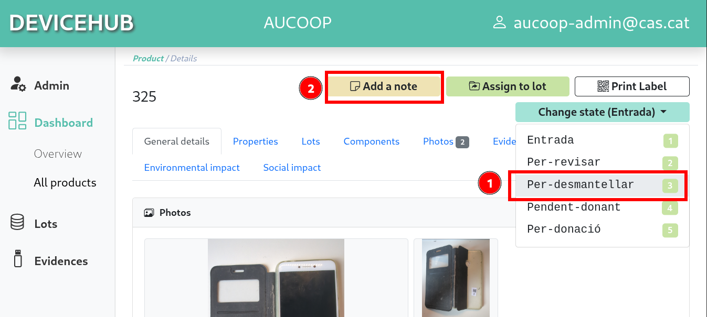{ width="533" loading=lazy }](guia/img/cfd164524bec.png)

        [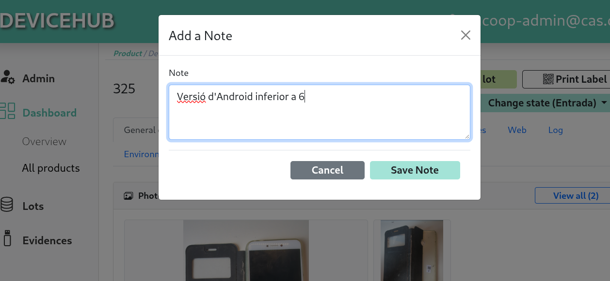{ width="533" loading=lazy }](guia/img/54f55450e14c.png)

    - **Android 6 exactament:** L'aplicació no funciona bé en aquesta versió. Apaga'l, posa-li un **gomet groc**, marca a DeviceHub l'estat Per-revisar amb la nota *"Android 6 - Procés manual"*. Deixa'l a la caixa groga.

        [{ width="533" loading=lazy }](guia/img/9f1e421a022f.png)

        [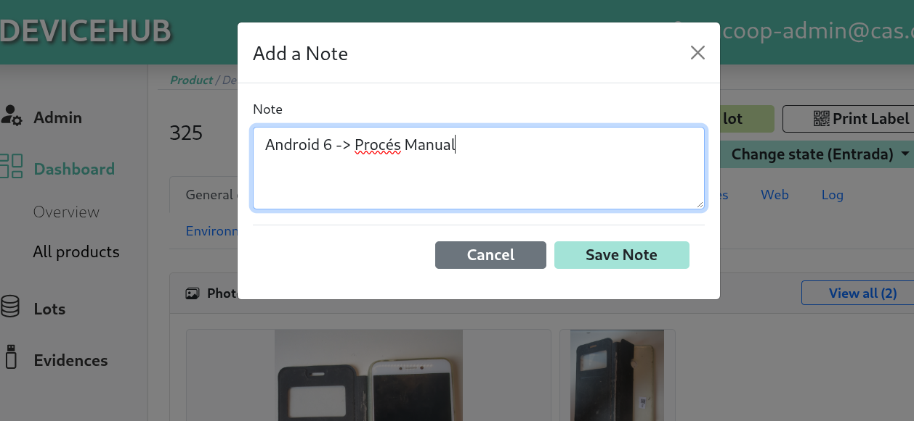{ width="533" loading=lazy }](guia/img/0237af2001b9.png)

    - **Android 7 o superior:** Seguim
- Amb el DRA, escaneja el QR o escriu [https://apps.sergiogimenez.com/workbench](https://apps.sergiogimenez.com/workbench)  al navegador.

    [{ width="200" loading=lazy }](guia/img/94c5d9dd0051.png)

- Aquesta app permet fer una revisió de l’estat del DRA de manera semiautomàtica.
- Si quan intentes executar l’aplicació dona un error:
    - Marca’l a DeviceHub com a estat Per-revisar i afegeix una nota indicant que *“**No carrega l’apk”*. Posa-li un gomet groc, apaga’l i deixa’l a la caixa groga. Un voluntari farà més tard el procés manualment.
    - Agafa un altre DRA i torna al pas 2 :).

        [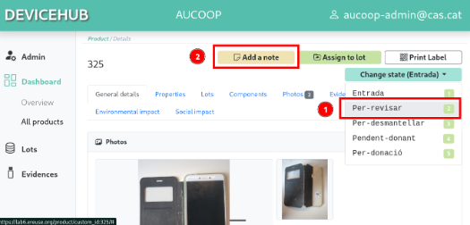{ width="533" loading=lazy }](guia/img/1484e51ade34.png)

        [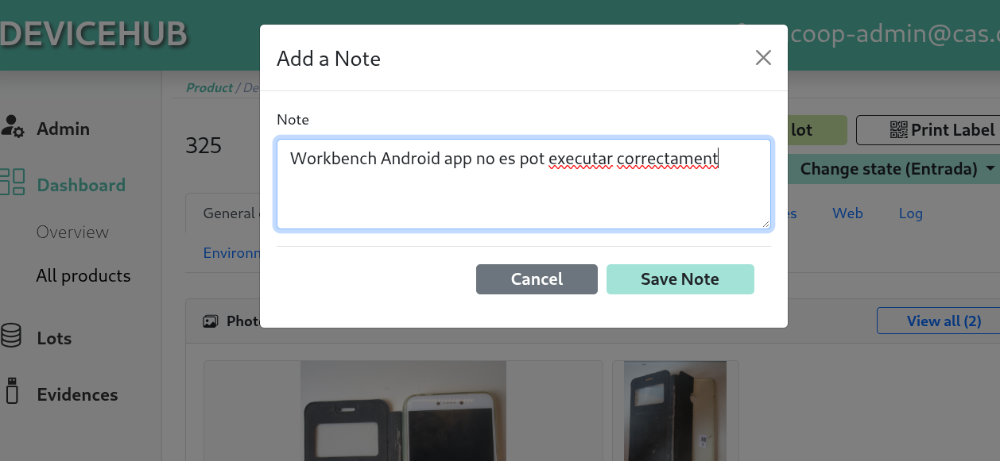{ width="533" loading=lazy }](guia/img/f299d99dfac7.png)

- Com que no és una app descarregada des del “Play Store”, potser el mòbil demana que acceptis instal·lació d'aplicacions de fonts desconegudes.

### 11. Configura Workbench (només la primera vegada) { #pas-11 }

- A la web de DeviceHub ves a la barra superior dreta i fes clic al teu nom d’usuari. Tria l’opció “My Tokens”. Pots crear-ne un si no en surt per defecte.

    [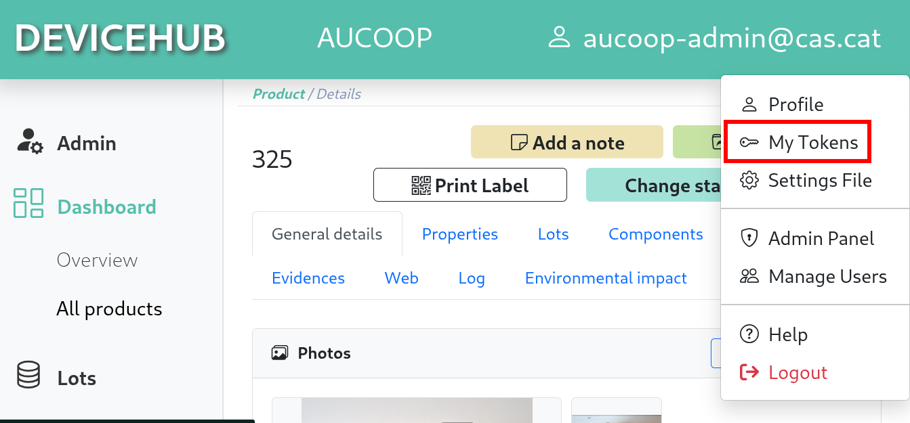{ width="533" loading=lazy }](guia/img/02db46c78811.png)

- Fes clic a “Show QR” i et sortirà el codi QR del token:

    [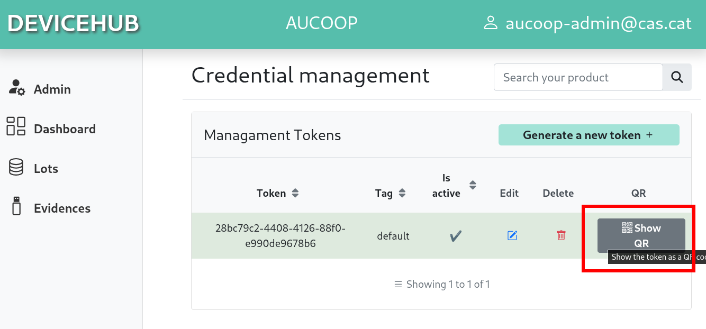{ width="533" loading=lazy }](guia/img/73e07173df8b.png)

    [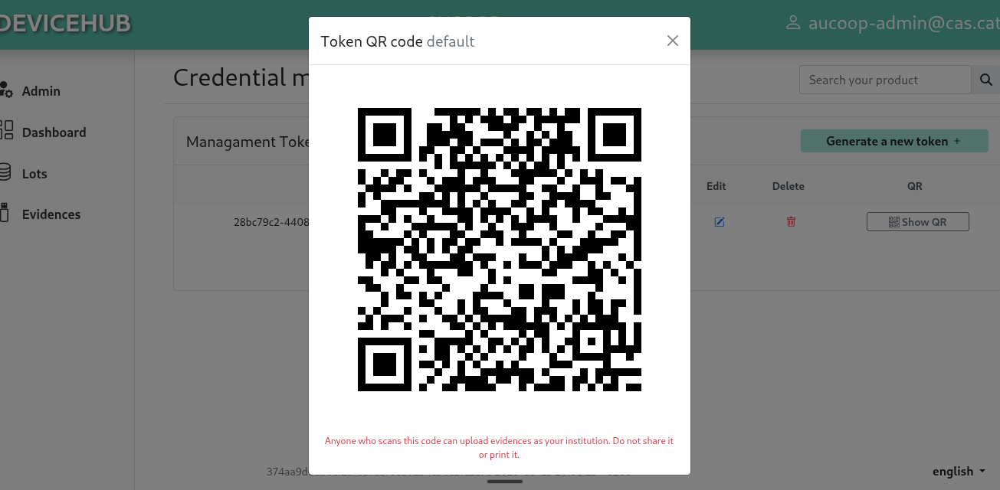{ width="533" loading=lazy }](guia/img/8315f1999814.png)

- Al DRA, obre la app “Workbench” amb el logo d’ereuse, toca “Server” i escaneja el QR:

    [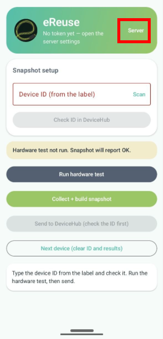{ width="212" loading=lazy }](guia/img/1e62087d9078.png)[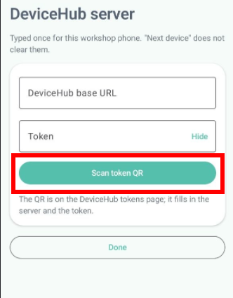{ width="200" loading=lazy }](guia/img/53778ef231f3.png)

    - Si s’ha escanejat correctament hauries de tenir les credencials de DeviceHub omplertes:

        [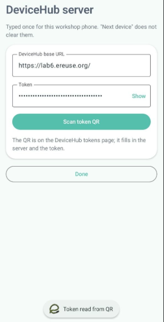{ width="225" loading=lazy }](guia/img/1c1d3850f9ee.png)

### 12. Fes el test { #pas-12 }

- Ara, en el teu DRA, busca l’etiqueta enganxada (la que hem vist en el Pas 3) i escriu el número de l'etiqueta al camp Device ID, o bé també fes clic a la paraula Scan i escaneja l'etiqueta del DRA:

    [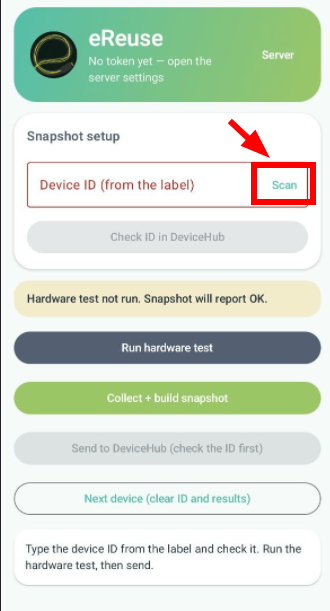{ width="238" loading=lazy }](guia/img/0b0555f4b928.png)[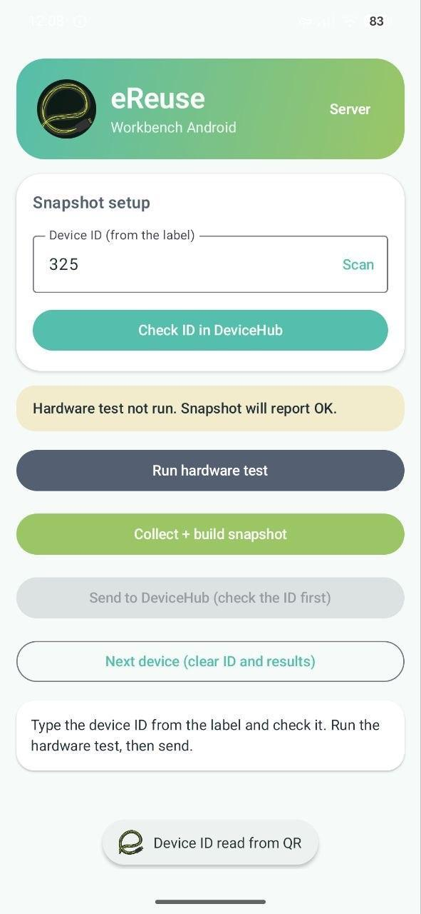{ width="203" loading=lazy }](guia/img/09163762fa27.png)

- Prem Check ID in DeviceHub per verificar que ja hem registrat el DRA prèviament a DeviceHub.
- Executa el test de maquinari tocant el botó de Run hardware test i segueix les indicacions de cada prova:

    [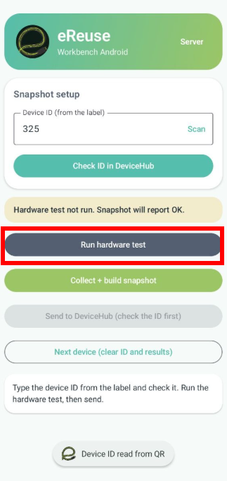{ width="208" loading=lazy }](guia/img/eae511ecc3a8.png)

- Quan hagis acabat, fes clic a “Collect + build snapshot”

    [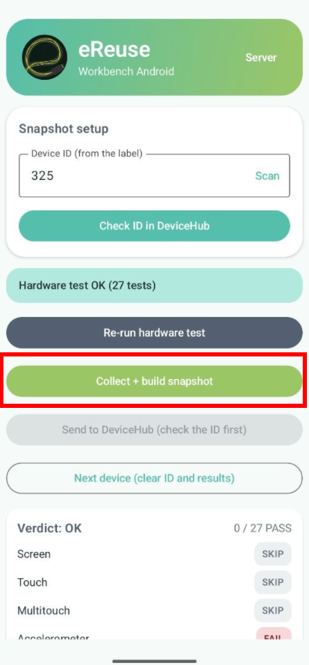{ width="205" loading=lazy }](guia/img/2b6fab2d8716.png)

- Quan acabis podràs veure els resultats dels tests que has executat i també de diverses dades del telèfon:

    [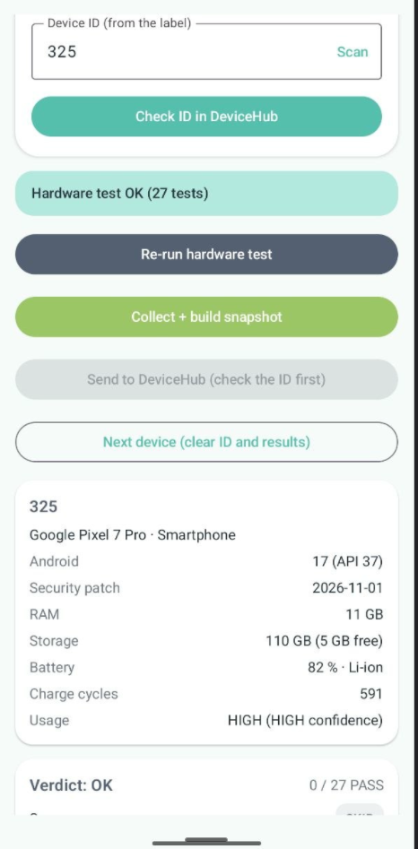{ width="217" loading=lazy }](guia/img/d7551419923b.png)

### 13. Envia'l i comprova'l a DeviceHub { #pas-13 }

- Toca “Send to DeviceHub”.

    [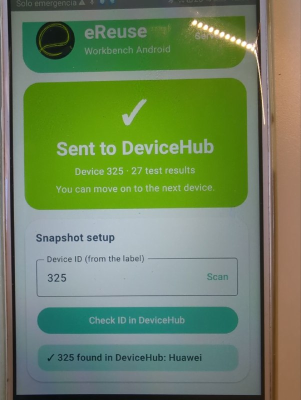{ width="200" loading=lazy }](guia/img/549a30b48dba.png)

- Si tot va bé, ara a DeviceHub hauries de poder veure tots els resultats a la pàgina del dispositiu.
    - Si vols veure’ls has d’anar a Dashboard -\> All Products i allà has de fer clic al Short ID del teu dispositiu

        [{ width="533" loading=lazy }](guia/img/3b1677078c5c.png)

    - Fent clic a Components veuràs els components que hem inclòs de manera manual en el registre i els que ha recopilat automàticament Workbench app.

        [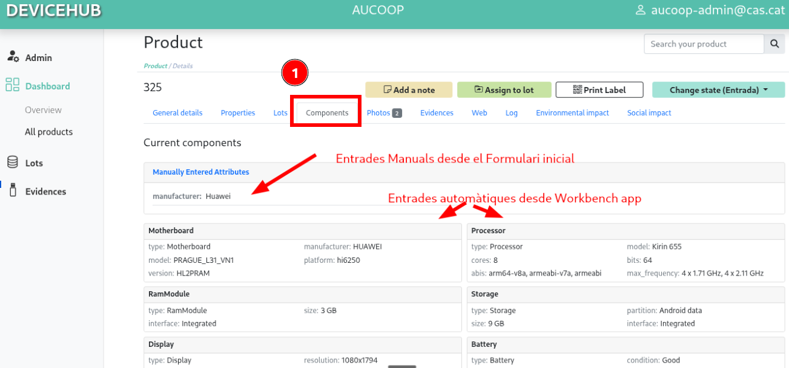{ width="533" loading=lazy }](guia/img/335303b4e5cc.png)

    - Fent clic a Properties veurem els resultats dels tests que hem fet en l’aplicació “Workbench”

        [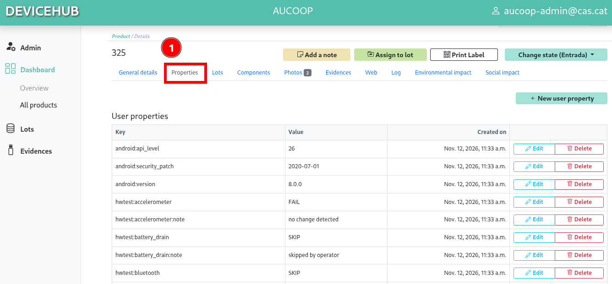{ width="533" loading=lazy }](guia/img/5c7b5e5f833f.png)

### 14. Si tot ha sortit bé { #pas-14 }

- A DeviceHub, canvia l'estat a Per-donació.
- Si li havies posat el compte de Google de Vincle Digital, treu-lo i fes-li un reset de fàbrica.
- Apaga'l i posa-li el gomet verd. Deixa'l a la caixa Per-donació amb el seu carregador i cable.
- Agafa'n un altre DRA de la caixa d'entrada, i torna a començar de nou.
- Si no ha sortit bé, anota a DeviceHub la problemàtica, marca l’estat Per-revisar, posa-li el gomet groc al DRA i deixa’l a la caixa Per-revisar.

## Recorda { #recorda }

- Comprova que l'estat a DeviceHub i la caixa coincideixen.
- Afegeix a DeviceHub la nota explicativa.
- Apaga el mòbil abans de deixar-lo a una caixa.
- Si trobes una SIM o una SD, avisa un voluntari.
- Torna el tester i el pinxo.
- Si tens dubtes, pregunta a un voluntari d‘AUCOOP!!!

[^1]: Massa antic vol dir que és evident que no suporta com a mínim un Android 6, perquè per exemple és un mòbil que té botons….
